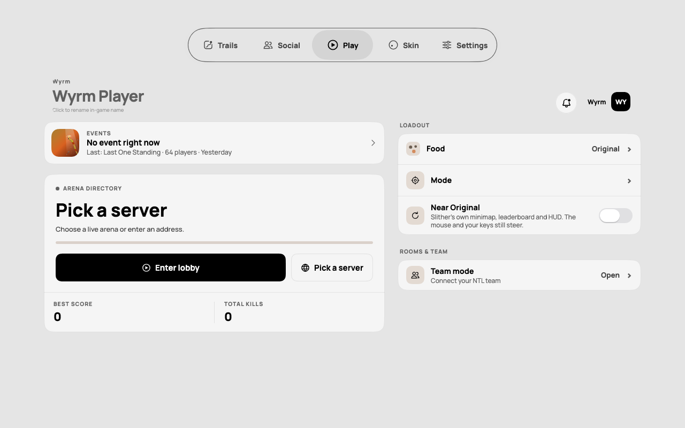
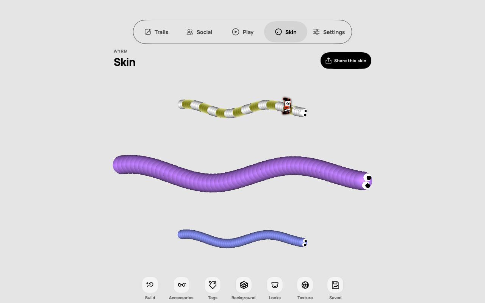

<p align="center">
  
</p>

<h1 align="center">Wyrm for Windows</h1>

<p align="center">
  The slither game app I've been building, now on your PC.<br>
  Windows 10 or newer, 64-bit.
</p>

<p align="center">
  <a href="https://github.com/disis-om/wyrm-desktop/releases/latest"><b>⬇&nbsp; Download the latest version</b></a>
</p>

<p align="center">
  
</p>

---

Hey! This is the Windows version of Wyrm. Same account, same skins, same
friends as on your phone or Mac. Log in and your settings follow you.

It runs on the same engine as the phone apps, so it's smooth, high FPS and
plays on the real slither.io servers. Mouse and keyboard, every key can be
changed in Settings › Controls.

<p align="center">
  &nbsp;
  
</p>

## Which file should I get?

Go to the [latest release](https://github.com/disis-om/wyrm-desktop/releases/latest)
and you'll see these:

| File | What it is |
| --- | --- |
| `WyrmSetup-<version>.exe` | **The normal installer.** Pick this one if you're not sure. |
| `Wyrm-<version>-portable.exe` | Portable. No install, run it from any folder or a USB stick. |
| `files.json` | Used by the app for updates. You don't need to download it. |

## Installing

1. Download `WyrmSetup-<version>.exe` and open it.
2. Click **Install**. It installs just for you, no admin password needed.
3. Open Wyrm from the Start menu or the desktop shortcut.

To remove it later, go to **Settings › Apps** in Windows and uninstall Wyrm
like any other app.

## "Windows protected your PC"? That's normal

I haven't paid for a code signing certificate yet, so the first time you run
the setup Windows SmartScreen might say it doesn't recognise the app. Nothing
is wrong with it, Windows just doesn't know me yet.

1. Click **More info**.
2. Click **Run anyway**.

You only have to do this once.

## Updates

You don't need to come back here for new versions. Wyrm checks by itself, and
when there's a new one you'll get a card in the app. Click **Update now** and
it only downloads the files that changed, then opens again on the new version.
The portable one updates itself too.

You can also check yourself in **Settings › Version**. Turn on
**Beta updates** there if you want new stuff a bit earlier than everyone else.

Every update is signed by me, and Wyrm won't install anything whose
signature, size or checksum doesn't match.

## Something not working?

Send me a message in Wyrm or on Discord and tell me your Windows version and
what happened. I'll take a look.

<details>
<summary>For developers: building from source</summary>

<br>

Wyrm for Windows builds the engine and the shared UI straight from Wyrm
Android's tree, so clone both side by side:

```
<folder>\Wyrm Android     <- github.com/disis-om/wyrm-android
<folder>\Wyrm Desktop     <- this repository
```

You need MSVC Build Tools 2022, the Android NDK 28.2 (its clang-cl), CMake,
Ninja, the Vulkan SDK and a full JDK 21 (Temurin, it has `jpackage`).

```
python native\patch_engine_desktop.py   :: once: adds the WYRM_DESKTOP blocks
native\build-native.cmd                 :: wyrm.dll, SDL3.dll, wyrmwin.dll, WyrmSetup.exe -> build\bin
cd shell
gradlew run                             :: run from source
gradlew createDistributable -PwyrmVersion=1.0.0 -PwyrmVersionCode=100
cd ..
python tools\package-wyrm-desktop.py --dry-run
```

Updates come from `update/latest.json` (stable) and `update/beta.json` (beta),
each with a `.sig`. The app only trusts a manifest whose signature checks out
against the public key built into it.

</details>

---

<p align="center">GPL-3.0, see <code>LICENSE</code>. © 2026 OM Rajput</p>
